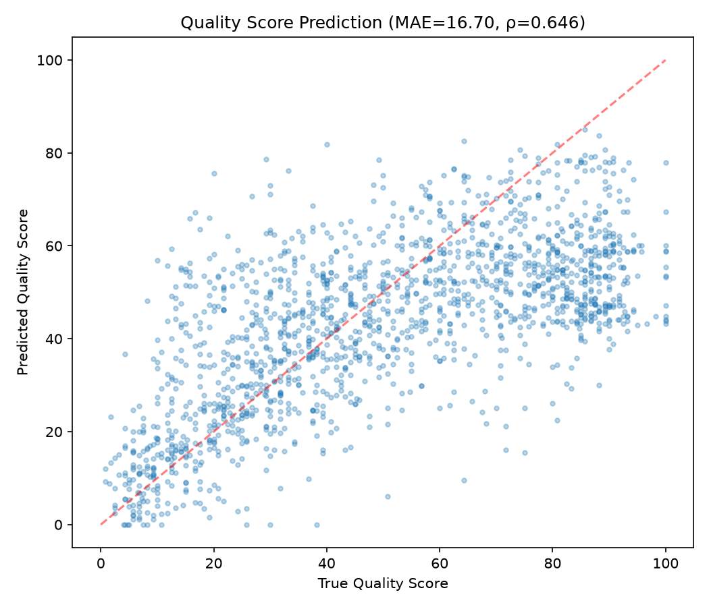
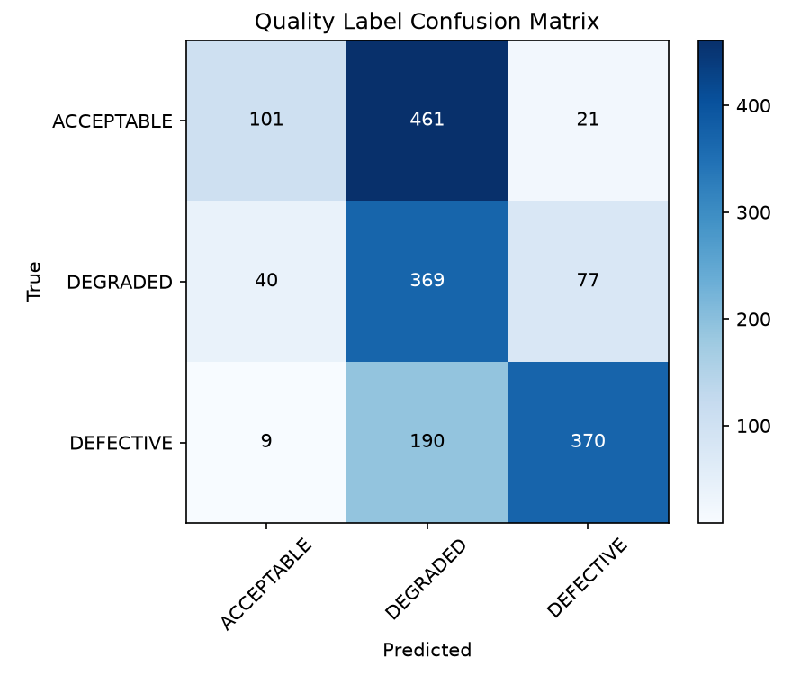
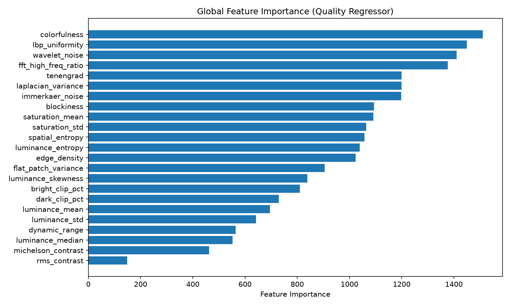

# Evaluation Report

**Model Version:** 1.0.0
**Training Date:** 2026-10-21T07:00:46.604851+00:00
**Training Samples:** 7056
**Test Samples:** 1638

## Issue Classification Metrics

| Issue Type | Precision | Recall | F1 | ROC-AUC | # Positive |
|---|---|---|---|---|---|
| blur | 0.984 | 0.621 | 0.761 | 0.950 | 195 |
| underexposure | 0.190 | 0.354 | 0.247 | 0.779 | 65 |
| overexposure | 1.000 | 0.139 | 0.243 | 0.853 | 65 |
| noise | 0.790 | 0.881 | 0.833 | 0.965 | 260 |
| compression_artifact | 1.000 | 0.192 | 0.323 | 0.944 | 130 |
| low_contrast | 0.000 | 0.000 | 0.000 | 0.801 | 65 |
| corruption | 0.000 | 0.000 | 0.000 | 0.793 | 65 |
| potential_defect | 0.884 | 0.694 | 0.777 | 0.897 | 780 |

## Quality Score Regression

- **MAE:** 16.698
- **RMSE:** 21.435
- **Spearman ρ:** 0.6456
- **Label Accuracy:** 0.5128

## Anomaly Detection

- **AUROC:** 0.6513
- **Precision:** 1.0
- **Recall:** 0.1428

## Feature Importance

## Failure Cases

| Filename | True Score | Predicted | Error | Issue Type |
|---|---|---|---|---|
| I19_10_01.png | 75.0 | 15.49 | 59.51 | compression_artifact |
| I23_25_01.png | 80.75 | 22.54 | 58.21 | low_contrast |
| I29_10_01.png | 88.25 | 30.09 | 58.16 | compression_artifact |
| I19.png | 100.0 | 43.23 | 56.77 | clean |
| I05.png | 100.0 | 43.78 | 56.22 | clean |
| I34.png | 100.0 | 44.17 | 55.83 | clean |
| I19_10_02.png | 71.75 | 16.06 | 55.69 | compression_artifact |
| I13_23_05.png | 20.0 | 75.64 | 55.64 | corruption |
| I23.png | 100.0 | 44.85 | 55.15 | clean |
| I23_08_02.png | 64.25 | 9.57 | 54.68 | potential_defect |

## Limitations

1. **Synthetic data bias**: The model is trained on KADID-10k degradations which are algorithmically generated. Real-world quality issues may differ.
2. **Content dependency**: Quality perception is content-dependent (e.g., noise is more noticeable on smooth areas). Our features partially capture this via patch-level analysis.
3. **Multi-degradation**: Images with multiple simultaneous issues may receive inconsistent predictions since training samples mostly have single degradations.
4. **Resolution sensitivity**: Features are extracted at KADID's native 512×384 resolution. Very different resolutions may shift feature distributions.
5. **Anomaly detector scope**: The Isolation Forest detects deviation from clean image distribution but cannot distinguish between types of anomalies.

## Baseline Comparison

| Issue Type | Logistic Reg. Acc | Random Forest Acc |
|---|---|---|
| blur | 0.8796 | 0.9299 |
| underexposure | 0.7189 | 0.9623 |
| overexposure | 0.8459 | 0.9478 |
| noise | 0.9511 | 0.9425 |
| compression_artifact | 0.7202 | 0.9153 |
| low_contrast | 0.709 | 0.9299 |
| corruption | 0.7017 | 0.9603 |
| potential_defect | 0.7407 | 0.7765 |